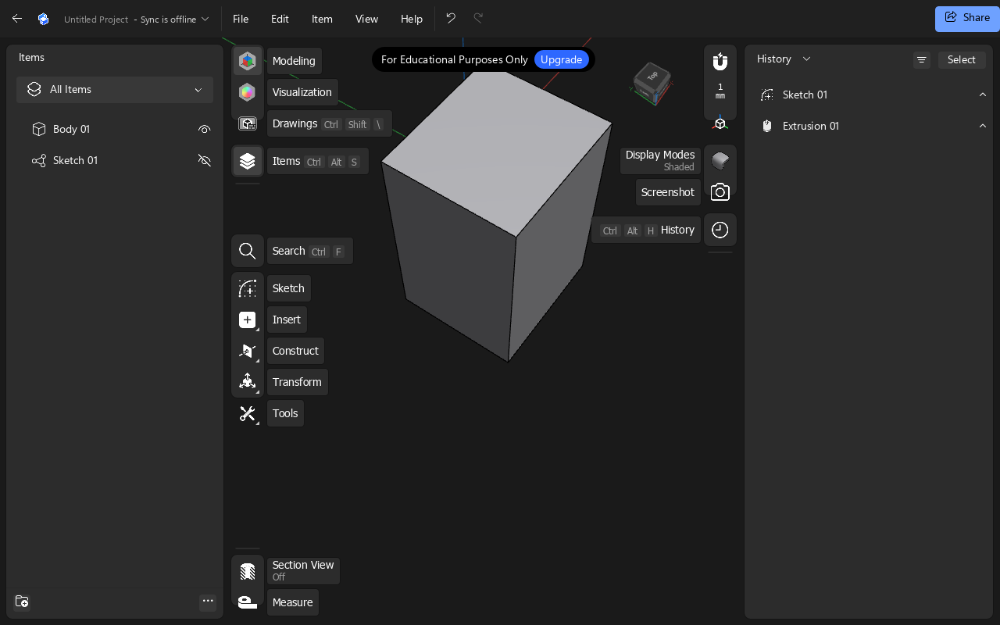
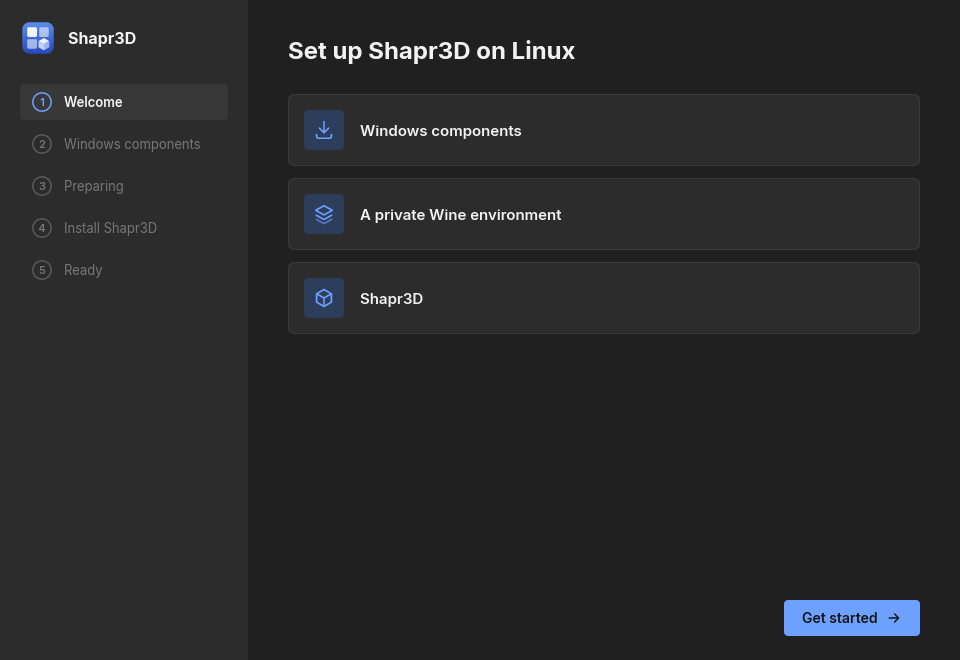

<h1 align="center">Shapr3D for Linux</h1>

<p align="center">
  Run the Windows version of <a href="https://www.shapr3d.com">Shapr3D</a> on Linux, from a single AppImage.
</p>

<p align="center">
  <a href="https://github.com/designgears/shapr3d-linux/releases/latest"><b>Download</b></a> ·
  <a href="#getting-started">Getting started</a> ·
  <a href="#troubleshooting">Troubleshooting</a> ·
  <a href="#building-from-source">Building</a>
</p>

<p align="center">
  
</p>

> **Beta.** Modelling, sketching, cloud sync, sign-in and export (STL, PDF drawings) work.
> Expect rough edges. This is an unofficial project, not affiliated with or supported by Shapr3D.

## Requirements

- 64-bit Linux with glibc 2.38 or newer: Ubuntu 24.04, Debian 13, Fedora 39 or anything more recent
- A GPU with working **Vulkan** drivers
- About **11 GB** of free disk space during setup, 4 GB afterwards
- A Shapr3D account, and the **Shapr3D for Windows** installer (`.msixbundle`)

## Getting started

1. **Download** `shapr3d-linux-<version>-x86_64.AppImage` from the
   [latest release](https://github.com/designgears/shapr3d-linux/releases/latest).
2. **Make it executable and run it:**
   ```sh
   chmod +x shapr3d-linux-*-x86_64.AppImage
   ./shapr3d-linux-*-x86_64.AppImage
   ```
3. **Follow the setup.** It runs once and takes 10-15 minutes, most of it the download:
   - **Windows components:** Shapr3D needs parts of Windows that Linux doesn't have. The setup downloads
     Microsoft's free Windows 11 evaluation image (7.1 GB) straight from Microsoft, takes out the few
     thousand files it needs, and deletes the image. You can also point it at a Windows 11 ISO you already have.
   - **Shapr3D:** choose the Shapr3D for Windows `.msixbundle` you downloaded.
4. **Launch Shapr3D** and sign in. Your browser opens to log in; when it asks to open Shapr3D, allow it, and
   you are signed in.

<p align="center">
  
</p>

After the first run, the same AppImage starts Shapr3D directly. The setup can add Shapr3D to your applications
menu, which is also what lets the browser hand the sign-in back.

## Good to know

- **Nothing is installed system-wide.** Everything lives in `~/.local/share/wine-uwp`.
- **Your files:** Shapr3D's open and save dialogs start in your Documents folder. Its own projects sync to
  your Shapr3D cloud account as usual.
- **Updates:** the AppImage carries update information, so
  [AppImageUpdate](https://github.com/AppImageCommunity/AppImageUpdate) and AppImage managers such as Gear Lever
  can update it in place. Or just download the new release.
- **Nothing of Microsoft's or Shapr3D's is in the download.** The AppImage holds only open-source code; the
  Windows components come from Microsoft and Shapr3D from your own installer, on your machine.

## Uninstalling

Delete the AppImage, then remove its data and menu entries:

```sh
rm -rf ~/.local/share/wine-uwp
rm -f ~/.local/share/applications/wine-uwp-shapr3d*.desktop
```

## Troubleshooting

**Shapr3D's window stays blank, or it closes right away.** Check that Vulkan works: `vulkaninfo --summary` should
list your GPU. After a kernel or graphics driver update, reboot before trying again.

**Signing in opens a second Shapr3D window, or nothing happens.** The browser hands the sign-in back through a
`shapr3d:` link. Run the setup again (`./shapr3d-linux-*.AppImage setup`), leave *Add to the applications menu* on,
and make sure no other Shapr3D-on-Linux install has claimed `shapr3d:` links (`xdg-mime query default
x-scheme-handler/shapr3d` should name `wine-uwp-shapr3d-handler.desktop`).

**The setup stopped halfway.** Start the AppImage again; it resumes where it stopped, including a partial download.

**Something else.** Logs are in `~/.local/share/wine-uwp/logs`. Please
[open an issue](https://github.com/designgears/shapr3d-linux/issues) with the log and what you were doing.

## How it works

Shapr3D for Windows is a packaged Windows Store (UWP) app, which plain Wine cannot run.
[wine-uwp](https://github.com/designgears/wine-uwp) is a patched Wine that can: it adds the app-package model,
composition, and the Windows Runtime pieces such apps need, and runs Microsoft's own UI frameworks on top. This
repository is the product around it: the setup app and the AppImage.

## Building from source

```sh
git clone --recurse-submodules https://github.com/designgears/shapr3d-linux
cd shapr3d-linux
./release.sh 0.0.1-dev
```

`release.sh` builds the AppImage from the pinned `wine-uwp` submodule into `out/<version>/`, with checksums, and
smoke-tests it: an empty setup on a private X display must reach Shapr3D's first screen. It needs:

- [flatpak-builder](https://flathub.org/apps/org.flatpak.Builder) with `org.freedesktop.Sdk//25.08` and its
  `mingw-w64` and `rust-stable` extensions. The AppImage is built inside that SDK so it runs on older distributions;
  nothing is shipped as a Flatpak.
- clang-cl, lld-link and the Windows SDK headers from [xwin](https://github.com/Jake-Shadle/xwin) in `~/xwin`,
  for wine-uwp's helper DLLs. They are only used to build, never shipped.
- For the smoke test: Xvfb, xdotool, ImageMagick, and `SMOKE_PACKAGE` (a Shapr3D `.msixbundle`) plus
  `SMOKE_ISO` (a Windows 11 ISO) or `SMOKE_WINDOWS` (an already extracted tree). `SMOKE=0` skips it.

| | |
| --- | --- |
| `installer/` | the setup app, in Rust and [Slint](https://slint.dev) |
| `appimage/` | the AppImage build (`build.sh`), its build environment, and the smoke test |
| `release.sh` | a versioned, tested release |
| `build-dist.sh` | an unpackaged build for development on your own machine |
| `wine-uwp/` | the engine, as a submodule |

For development against a wine-uwp checkout beside this one, the scripts use `../wine-uwp` (or `WINE_UWP`) instead
of the submodule. Enable the commit hook once per clone with `git config core.hooksPath githooks`: it refuses
Microsoft's files and large binaries.
